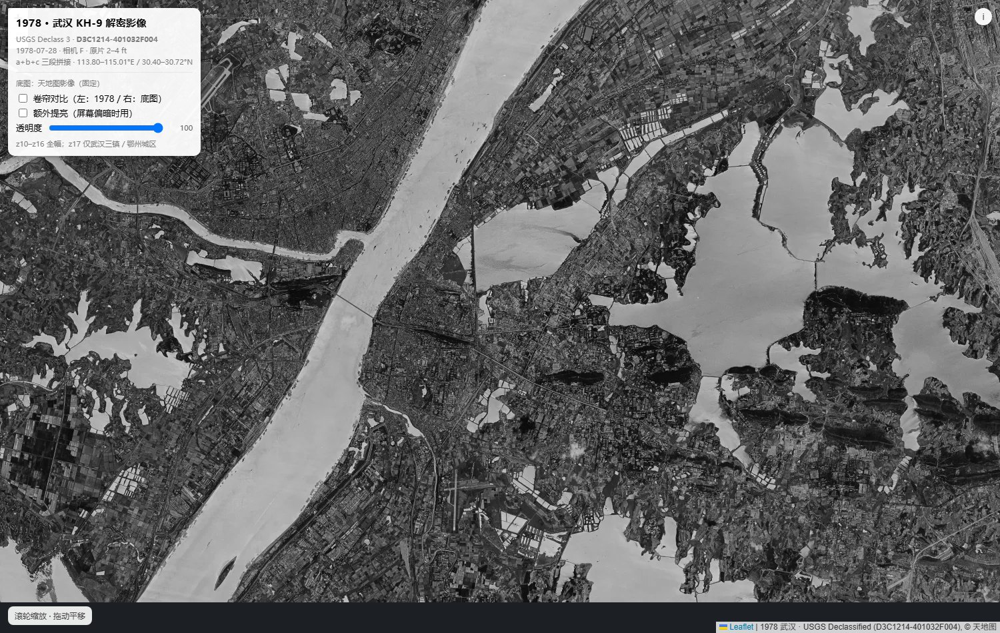

# 武汉 · KH-9 解密影像 1978 / 1984（USGS Declass 3）

两期 KH-9 黑白影像，USGS 解密扫描件，按控制点配准到 WGS84 / Web Mercator，拼接后切成 XYZ 瓦片：

- **1978-07-28**　`D3C1214-401032F004`　113.80–115.01°E / 30.40–30.72°N（武汉三镇—鄂州），原片 1.09 m
- **1984-01-03**　`D3C1218-301275A003` + `A004`　113.71–114.65°E / 30.38–30.78°N（汉口北—黄陂—孝感南），原片 ≈1.7 m

同一页面顶部切换年份，直接对比今天的地图。



**在线访问 → <https://ewlaker.github.io/wuhan1978/>**（本地预览：`serve.ps1` 起 8099 端口）

---

## 一、页面功能

| 功能 | 说明 |
|---|---|
| 底图 | 固定天地图影像（key 缺失时自动退到 OSM） |
| **卷帘对比** | 左 1978、右底图，拖中间圆柄（1978 独立 pane，不抢底图事件） |
| 透明度 | 20–100%，直接改 1978 图层的 pane opacity，压上去找变化 |
| 百分比截断 | 瓦片本身已做 Percent Clip 拉伸（1% / 0.25%），页面上另有「额外提亮」开关兜底 |
| URL 定位 | `?z=12&lat=30.545&lon=114.32&base=tdt_img`；卷帘直连 `?swipe=1&pos=50` |

## 二、数据规格

| 项 | 值 |
|---|---|
| 场景 | 1978：`D3C1214-401032F004`；1984：`D3C1218-301275A003/A004` |
| 原片分辨率 | 2–4 ft（≈0.6–1.2 m） |
| 本批范围 | 1978 113.80–115.01°E；1984 113.71–114.65°E |
| 瓦片 | 1978 z9–16 + 城区 z17；1984 z9–16 |
| 瓦片规格 | 256 px、WebP q82、EPSG:3857、墨卡托 XYZ、空白透明 |
| 体量 | 33,419 张 / 451 MB（两期合计；全透明瓦片已剔除） |
| 配准 | ArcGIS Pro 控制点（非正射），城区江岸误差量级数十米，不作量测依据 |
| 接缝 | a+b 段与 c 段的胶片黑边已作 nodata 处理、由相邻段影像填补，中间无空洞/黑带 |

## 三、目录

```
├── index.html              单页 Leaflet
├── preview.jpg             首页截图
├── xyz_1978_webp/          1978 z9–16 瓦片
├── xyz_1978_z17/           1978 城区 z17 瓦片
├── xyz_1984_webp/          1984 z9–16 瓦片
├── 发布说明.md              数据来源、复现命令、配准精度、踩坑
├── 404.html · .nojekyll    Pages 用
└── ../01_mosaic/           拼接件：ba_3857.tif · c_3857.tif · mosaic_abc.vrt · mask_1_8.tif · mosaic_abc_rgba.vrt
    ../scripts/             1a/1b 纠正 → 2 拼接 → 3 掩膜 → 4 切瓦片（rebuild.ps1 一键）
```

## 四、重新配准后重建

控制点存在各 `tif` 的 `.tif.aux.xml` 里，ArcGIS 里改完保存即可，然后：

```powershell
cd E:\1978武汉KH9\scripts
.\rebuild.ps1            # 全流程约 11 分钟
.\rebuild.ps1 -Only c    # 只改了 c 段
```

细节与选点建议见 [发布说明.md](发布说明.md) 第五节。

## 四、注意

- **非正射**：山丘、高层建筑有侧视位移；配准只到「叠加浏览」级别。
- USGS 扫描件另有 **d 段**（无控制点，内容为相邻两帧的残段），未纳入；补齐需另做配准。
- 片框黑边与胶片注记（`28JUL78`、`R2166` 等）保留为影像的一部分，未裁掉。
- 天地图需要 key，页面里的 `TDT_KEY` 是借用的，建议自行申请。

## 三种浏览模式

| 模式 | 说明 | URL |
|---|---|---|
| 单图 | 选一个年份，按需勾选分幅 | ?mode=single&y=1978 |
| 卷帘 | 上方/下方图层各选一个（底图或任一年份），左右拖动对比 | ?mode=swipe&top=1966&bottom=1984 |
| 双屏 | 两个地图并排，平移/缩放联动 | ?mode=dual&left=1966&right=1984 |

图层单位是「年份整层」：选 1966 会同时带出 c/d 两幅，选 1984 带出 A003/A004。
双屏联动用 move 事件 + 同步锁；卷帘裁剪用 pane 本地坐标 polygon（pane 会随平移偏移，
inset() 会裁掉盒子左侧内容）。

## 空间红线

站点 992 MB / 6.98 万文件（Pages 限额 1 GB / 10 万）。**不新增仓库**，
放不下时一律「缩小 z17 范围」换空间，不降低切图质量。
